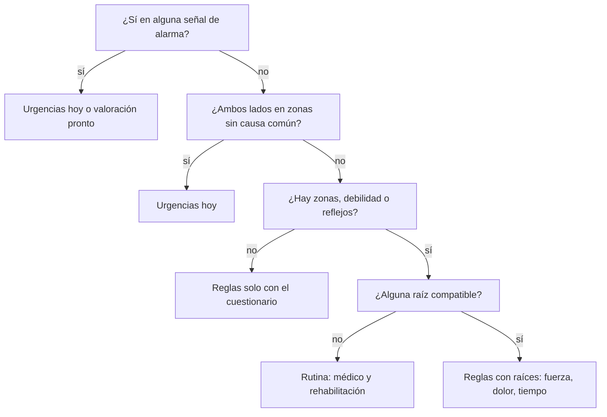

# Raíz: revisión clínica del contenido

26 de octubre de 2026

## Cómo usar este documento

Raíz es una herramienta educativa: una persona con dolor de espalda o cuello responde un triage, un cuestionario de dolor, un mapa del cuerpo y pruebas de fuerza, y recibe qué hacer, con qué urgencia y qué puede estar causando sus síntomas. No diagnostica ni guarda datos.

Todo el contenido clínico que sigue está **pendiente de revisión** y no debe publicarse sin ella. Se pide revisar tres cosas:

- **Exactitud:** que cada dato clínico sea correcto y esté bien citado.
- **Seguridad:** que ninguna regla deje sin derivar a urgencias a quien lo necesita.
- **Lenguaje:** que los textos para el paciente se entiendan sin conocimientos médicos.

Fuera de alcance: el diseño visual y el código. Para opinar sobre un punto, escribe tu comentario debajo de él o respóndelo en un correo citando la sección; las preguntas abiertas para el clínico están marcadas como **Pregunta**.

Estado del contenido: rama `master`, commit `6a31cd0`, migraciones de base de datos V1 a V10.

## Señales de alarma del triage

Diez preguntas de sí o no abren la evaluación. Un "sí" en cualquiera corta todo lo demás: las cinco primeras mandan a urgencias hoy y las otras cinco, a valoración médica pronto. Las cinco urgentes también aparecen en cada resultado no urgente, bajo "Cuándo ir a urgencias".

| Código | Texto que lee el paciente | Deriva a |
| --- | --- | --- |
| SADDLE_ANESTHESIA | Se te duerme o no sientes la zona entre las piernas: genitales, ano o la parte interna de los glúteos | Urgencias hoy |
| BLADDER_OR_BOWEL_DYSFUNCTION | Te cuesta orinar o no puedes, o se te escapa la orina o el excremento sin querer | Urgencias hoy |
| PROGRESSIVE_WEAKNESS | Pierdes fuerza en un brazo o una pierna y va a más con los días; por ejemplo, el pie se te arrastra | Urgencias hoy |
| BILATERAL_SYMPTOMS | Sientes hormigueo, adormecimiento o debilidad en las dos piernas o en los dos brazos | Urgencias hoy |
| GAIT_OR_HAND_CLUMSINESS | Notas torpeza nueva al caminar o con las manos: se te caen las cosas o te cuesta abrocharte | Urgencias hoy |
| FEVER | Tienes fiebre además del dolor de espalda o de cuello | Valoración pronto |
| UNEXPLAINED_WEIGHT_LOSS | Has bajado de peso sin proponértelo | Valoración pronto |
| CANCER_HISTORY | Has tenido cáncer alguna vez | Valoración pronto |
| SIGNIFICANT_TRAUMA | El dolor empezó después de un golpe o una caída fuerte | Valoración pronto |
| UNRELENTING_NIGHT_PAIN | De noche el dolor no te deja descansar en ninguna postura | Valoración pronto |

Mensajes que acompañan cada derivación:

- **Urgencias hoy:** "Estos síntomas pueden indicar que la médula o los nervios del final de la columna están muy apretados. No esperes: acude a urgencias." Más "Si no puedes llegar por tu cuenta, llama al 911."
- **Valoración pronto:** "Antes de cualquier tratamiento, un médico debe descartar otras causas del dolor, como una infección, una fractura o un tumor."

**Pregunta:** ¿Falta alguna señal? Por ejemplo, edad de inicio (menor de 20 o mayor de 50), uso prolongado de corticoides, inmunosupresión o drogas intravenosas.

**Pregunta:** ¿Es correcto que fiebre, pérdida de peso, cáncer previo, trauma y dolor nocturno deriven a "pronto" y no a urgencias? ¿Debería la fiebre con dolor intenso subir a urgencias?

**Pregunta:** "Torpeza nueva" en las manos o al caminar manda a urgencias hoy. ¿Es proporcionado, o una mielopatía de inicio lento debería ir a "pronto"?

Fuente: el código no cita una fuente para esta lista; ver la sección de huecos.

## Reglas del motor

Después del triage, el motor decide en tres pasos y, en cada lista de reglas, la primera que aplica gana. Siempre devuelve una derivación con urgencia y especialistas.

Las dos salidas de urgencias son las primeras. Si lo bilateral estaba solo en zonas con causa común, cualquier salida de rutina sube a "próximos días".

### 1. Síntomas en ambos lados

Si hay hallazgos en los dos lados de una misma región (cervical o lumbosacra), el motor lo trata como la señal de alarma "ambos lados" y manda a urgencias hoy, aunque el triage haya sido "no".

- **Debilidad y reflejos cuentan siempre:** son pérdida de función.
- **Excepción:** las zonas sensitivas con causas bilaterales frecuentes no cuentan como alarma. Hoy son la ingle (pubalgia, cadera; Weir 2015) y pulgar, índice y medio (túnel carpiano, bilateral en el 80.7% de 327 pacientes; PLoS ONE 2021).
- **En ese caso** la derivación sube de rutina a "próximos días", pone al médico general primero y explica que suele ser una causa no urgente.

### 2. Puntuación de raíces

Cada raíz, por lado, suma puntos por cada hallazgo de su territorio:

| Hallazgo | Puntos |
| --- | --- |
| Zona sensitiva marcada en el mapa | 2 |
| Debilidad en una prueba de fuerza | 3 |
| Reflejo disminuido (solo modo profesional) | 3 |

Las raíces se ordenan de mayor a menor puntuación; los empates, en orden anatómico. Una raíz con debilidad o reflejo se marca con "pérdida de fuerza o de reflejos".

### 3. Derivación

| Situación | Condición (en orden) | Urgencia | Especialistas, en orden |
| --- | --- | --- | --- |
| Hay raíces compatibles | Pérdida de fuerza o reflejos | Próximos días | Traumatólogo de columna o neurocirujano; neurólogo |
| Hay raíces compatibles | Dolor 8 o más de 10 | Próximos días | Médico; traumatólogo de columna |
| Hay raíces compatibles | Más de 12 semanas | Rutina | Traumatólogo de columna; rehabilitación |
| Hay raíces compatibles | Ninguna de las anteriores | Rutina | Rehabilitación; fisioterapeuta; traumatólogo de columna |
| Solo cuestionario | Dolor de nervio y 8 o más | Próximos días | Médico; traumatólogo de columna |
| Solo cuestionario | Dolor de nervio | Rutina | Rehabilitación; fisioterapeuta; traumatólogo de columna |
| Solo cuestionario | Más de 12 semanas | Rutina | Rehabilitación; fisioterapeuta |
| Solo cuestionario | Ninguna de las anteriores | Rutina | Fisioterapeuta; rehabilitación |
| Zonas sin raíz compatible | Siempre | Rutina | Médico; rehabilitación |

Duración: menos de 6 semanas es agudo, de 6 a 12 subagudo y más de 12 crónico.

**Pregunta:** ¿Son correctos los pesos 2, 3 y 3, y el umbral de dolor intenso en 8 de 10?

**Pregunta:** ¿Hay otras zonas con causas bilaterales frecuentes que no deban mandar a urgencias? Por ejemplo, la cara posterior de ambos muslos.

**Pregunta:** El dolor de nervio con 8 o más de 10 sube a "próximos días", pero el dolor no nervioso igual de intenso se queda en rutina. ¿Es correcto?

## Catálogo de raíces

Once raíces, C5–T1 y L1–S1. Su territorio es lo que el motor compara con el mapa y las pruebas de fuerza; un error aquí cambia qué raíz aparece como compatible.

| Raíz | Zonas de sensibilidad | Movimientos | Reflejo | Disco que suele comprimirla | Pruebas de provocación |
| --- | --- | --- | --- | --- | --- |
| C5 | Hombro y brazo, por fuera | Separar el brazo; doblar el codo | Bicipital | C4-C5 | Spurling; ULTT |
| C6 | Antebrazo, lado del pulgar; pulgar; índice | Extender la muñeca; doblar el codo | Braquiorradial; bicipital | C5-C6 | Spurling; ULTT1 (mediano) |
| C7 | Dedo medio | Estirar el codo; flexionar la muñeca | Tricipital | C6-C7 | Spurling; ULTT1 |
| C8 | Anular; meñique; antebrazo, lado del meñique | Cerrar el puño | — | C7-T1 | ULTT3 (cubital) |
| T1 | Brazo, por dentro | Separar los dedos | — | T1-T2 | ULTT3 |
| L1 | Ingle | Levantar el muslo | — | T12-L1 posterolateral; L1-L2 foraminal | Femoral (débil) |
| L2 | Ingle; muslo por delante, parte alta | Levantar el muslo; juntar las piernas | — | L1-L2 posterolateral; L2-L3 foraminal | Femoral |
| L3 | Muslo por delante; rodilla por dentro | Estirar la rodilla; juntar las piernas | Rotuliano | L2-L3 posterolateral; L3-L4 foraminal | Femoral |
| L4 | Rodilla, pierna y tobillo por dentro | Estirar la rodilla; levantar la punta del pie | Rotuliano | L3-L4 posterolateral; L4-L5 foraminal | Femoral; SLR |
| L5 | Pierna por fuera; empeine; dedo gordo | Levantar el dedo gordo; levantar la punta del pie; separar la pierna | — | L4-L5 posterolateral; L5-S1 foraminal | SLR; slump; SLR cruzado |
| S1 | Pie, borde de afuera; planta; pantorrilla; muslo por detrás | Pararse de puntas; girar el pie hacia afuera | Aquíleo | L5-S1 posterolateral | SLR; slump |

Cada raíz tiene además un resumen para el paciente y notas clínicas (V3, y V5 para L1–L3), que la API solo muestra a profesionales.

Fuentes: Lee 2008 (dermatomas) para todas; Bono 2011 (NASS, cervical), Wainner 2003, Rubinstein 2007 y Radhakrishnan 1994 para C5–T1; Kreiner 2014 (NASS, lumbar), NICE NG59 y Devillé 2000 para L1–S1.

**Pregunta:** ¿Es correcto asignar "muslo por detrás" a S1? Muchas cartas lo reparten entre S1 y S2, y el catálogo no tiene S2.

**Pregunta:** Los territorios se solapan y varían entre personas, y el resultado lo dice. ¿Hace falta marcar alguna zona como poco fiable?

## Otras causas por zona

Cuando la persona marca una zona, el resultado lista causas frecuentes distintas de una raíz nerviosa, cada una con su fuente. Las marcadas como bilaterales comunes son las que evitan la alarma de "ambos lados" (regla 1 del motor).

| Causa | Zonas | Texto que lee el paciente | Bilateral común | Fuente |
| --- | --- | --- | --- | --- |
| Pubalgia | Ingle | Dolor en el pubis y en los músculos que se insertan en él: aductores y abdominales. Suele doler al apretar el pubis, al hacer abdominales, patear o correr, y con frecuencia de ambos lados. | Sí | Weir 2015 |
| Cadera | Ingle | El dolor de la articulación de la cadera se siente en la ingle, no en el costado. Suele empeorar al girar la pierna, sentarse en un asiento bajo o cruzar las piernas. | Sí | Weir 2015 |
| Nervio atrapado en la ingle | Ingle | Los nervios que pasan por la ingle (obturador, ilioinguinal, genitofemoral) pueden quedar atrapados entre músculos o tejidos y dar ardor u hormigueo en la ingle, junto a los genitales o en la cara interna del muslo. | No | Bradshaw 1997 |
| Dolor referido desde la columna baja | Ingle | Discos más bajos de la columna, como L4-L5, pueden doler en la ingle aunque no irriten las raíces de esa zona. | No | Yukawa 1997; Nakamura 1996 |
| Túnel carpiano | Pulgar, índice, medio | El nervio mediano se aprieta a su paso por la muñeca. Da hormigueo en el pulgar, el índice y el medio, suele empeorar de noche o al usar la mano, y con frecuencia afecta ambas manos. | Sí | Padua 2016; PLoS ONE 2021 |

Además, el resumen para el paciente de L1 y L2 avisa que el dolor de ingle puede venir de discos bajos (L4-L5), de la cadera, de la pubalgia, de un nervio atrapado o de una hernia inguinal. Las notas clínicas de L1–L3 añaden la vía del nervio sinuvertebral por L2 (Yukawa 1997: 4.1% de 512 hernias lumbares bajas con dolor inguinal; Nakamura 1996) y las neuropatías por atrapamiento.

**Pregunta:** ¿Faltan causas frecuentes en otras zonas? Por ejemplo, meralgia parestésica (muslo por fuera, zona que hoy no está en el mapa), nervio cubital en el codo (meñique) o síndrome piriforme (muslo por detrás).

**Pregunta:** El texto de "Dolor referido desde la columna baja" usa la palabra "raíces". ¿Se entiende, o debe decir "nervios"?

**Pregunta:** ¿Debería la hernia inguinal ser una causa propia en esta lista, y no solo una mención en el resumen de L1?

## Cuestionario de dolor y patrón

El cuestionario clasifica el dolor en uno de cuatro patrones; la primera regla que se cumple gana. El patrón se muestra en "Qué puede ser" y, si es de nervio, influye en la derivación.

**Preguntas:** dónde empieza (cuello, espalda baja o ambos), hasta dónde llega desde cada uno, intensidad de 0 a 10, fecha de inicio, cómo se siente, qué lo empeora y qué lo alivia. Al final van los antecedentes (sección siguiente a Fuerza guiada).

| Patrón | Se cumple si | Texto que lee el paciente |
| --- | --- | --- |
| De nervio (radicular) | Ardor, hormigueo, adormecimiento o descarga eléctrica, **y** el dolor pasa del codo o de la rodilla o hay zonas marcadas | Se parece al dolor de un nervio irritado a su salida de la columna. Una hernia de disco es una causa frecuente, pero no la única. |
| De disco | 2 puntos o más: 1 por cada agravante entre estar sentado, agacharse, toser o estornudar y cargar peso; 1 si alivia acostarse o caminar suave | Se parece al dolor que viene de un disco de la columna, sin señales claras de que un nervio esté irritado. |
| Sensible a la extensión | Empeora al inclinarse hacia atrás o estar de pie mucho tiempo, **y** alivia sentarse | Se parece más al dolor de las pequeñas articulaciones de la columna que al de una hernia. |
| Inespecífico | Ninguno de los anteriores | Los rasgos del dolor no apuntan a una causa concreta. Es el tipo de dolor más común y suele mejorar retomando la actividad poco a poco. |

**Opciones de las preguntas:**

- **Cómo se siente:** ardor o quemazón, hormigueo, adormecimiento, como descarga eléctrica (las cuatro cuentan como de nervio), dolor sordo, punzada, rigidez.
- **Qué lo empeora:** estar sentado, agacharse, toser o estornudar, cargar peso (estas cuatro suman para disco), inclinarse hacia atrás, estar de pie mucho tiempo, caminar, estar acostado.
- **Qué lo alivia:** acostarse, caminar suave, sentarse, cambiar de postura, nada lo alivia.
- **Hasta dónde llega:** solo en el cuello o la espalda baja; hasta el hombro, el brazo, el glúteo o el muslo sin pasar del codo o la rodilla; pasa del codo o la rodilla.

**Pregunta:** el código no cita una fuente para estas reglas. ¿Coinciden con la evidencia sobre preferencia direccional y patrones de dolor discal y facetario?

**Pregunta:** ¿Debería el patrón de nervio exigir que el dolor pase del codo o de la rodilla, o basta con ardor u hormigueo en una zona marcada?

## Fuerza guiada

El paso aparece solo si el dolor baja o hay zonas marcadas. Las pruebas de pierna se muestran si el dolor empieza en la espalda baja; las preguntas de brazo, si empieza en el cuello.

### Pruebas de pierna

Cada prueba lleva el aviso "Apóyate en una pared y detente si el dolor sube claramente". Las raíces se derivan del catálogo, no se guardan aparte.

| Prueba | Instrucción | Movimiento | Raíces |
| --- | --- | --- | --- |
| Caminar de talones | Da 10 pasos con la punta del pie levantada. | Levantar la punta del pie | L4, L5 |
| Caminar de puntas | Da 10 pasos sobre la punta de los pies. | Pararse de puntas | S1 |
| Elevación de talón a una pierna | Haz 10 repeticiones por lado, apoyado en la pared, y compara ambos lados. | Pararse de puntas | S1 |
| Dedo gordo contra resistencia | Levanta el dedo gordo mientras un dedo de la mano lo empuja hacia abajo. | Levantar el dedo gordo | L5 |
| Levantarse de una silla con una pierna | Levántate con apoyo de una mano y compara ambos lados. | Estirar la rodilla | L3, L4 |
| Apoyo en una pierna | Sostente 20 segundos sobre una pierna; la cadera del lado contrario no debe caer. | Separar la pierna | L5 |

Respuestas: igual en ambos lados, más débil del lado derecho, más débil del lado izquierdo, no pude por dolor, no la hice. **Solo "más débil" cuenta como debilidad**, con su lado, y suma 3 puntos a las raíces de ese movimiento. "No pude por dolor" aparece en el resultado como algo para comentar en la consulta.

### Preguntas de brazo

Probar la fuerza del brazo a solas es poco fiable, así que se pregunta por tareas diarias. Estas respuestas **no cuentan como debilidad**: aparecen en "Coméntalo en tu consulta".

| Pregunta | Movimiento | Raíces |
| --- | --- | --- |
| ¿Te cuesta levantar el brazo hacia un lado, por ejemplo para peinarte o alcanzar algo alto? | Separar el brazo del cuerpo | C5 |
| ¿Te cuesta doblar el codo para cargar algo, como una bolsa del súper? | Doblar el codo | C5, C6 |
| ¿Te cuesta estirar el brazo para empujar, como al levantarte de una silla apoyando las manos? | Estirar el codo | C7 |
| ¿Te falta fuerza para apretar con la mano, como al abrir un frasco o exprimir un trapo? | Cerrar el puño con fuerza | C8 |

Respuestas: no, sí el brazo derecho, sí el brazo izquierdo, sí los dos.

**Pregunta:** no hay opción "débil de los dos lados" en las pruebas de pierna. La debilidad bilateral manda a urgencias, pero juzgarla a solas da falsas alarmas; hoy se pregunta solo en el triage. ¿Es suficiente?

**Pregunta:** "Sí, los dos" en las preguntas de brazo no cambia la urgencia. ¿Debería subirla, por posible mielopatía?

**Pregunta:** ¿Son seguras estas pruebas para hacer en casa? ¿Falta una pregunta para T1 (separar los dedos)?

## Antecedentes

Dos preguntas opcionales al final del cuestionario de dolor. **No cambian puntos ni urgencia:** solo informan al profesional.

| Pregunta | Respuestas | Qué hace la app |
| --- | --- | --- |
| ¿Te han diagnosticado una hernia de disco antes? | Sí, no, no sé. Con "sí", niveles opcionales: C4-C5, C5-C6, C6-C7, C7-T1, T12-L1, L1-L2, L2-L3, L3-L4, L4-L5, L5-S1 | Nota en "Coméntalo en tu consulta" y coincidencia en "Para tu médico" |
| ¿Te han operado de la columna? | Sí, no | Solo nota en "Coméntalo en tu consulta" |

**Regla de coincidencia:** una raíz compatible se señala si alguno de los discos que suelen comprimirla (catálogo de raíces) es el nivel de la hernia previa. Por ejemplo, una hernia previa L4-L5 se señala en L5 (L4-L5 posterolateral) y en L4 (L4-L5 foraminal).

Textos que lee el paciente:

- En "Para tu médico", bajo la raíz: "Coincide con tu hernia previa L4-L5."
- En "Coméntalo en tu consulta": "Te diagnosticaron una hernia de disco antes (L4-L5)." y "Te han operado de la columna."

**Pregunta:** ¿Debería una hernia previa en el mismo nivel sumar puntos a esa raíz? Hoy no lo hace porque no hay una fuente que diga cuánto debería pesar.

**Pregunta:** ¿Debería una cirugía previa cambiar la derivación, por ejemplo hacia quien operó, o mencionar recidiva o fibrosis como otras causas?

**Pregunta:** Los niveles se ofrecen según dónde empieza el dolor. ¿Hace falta ofrecer niveles torácicos o T1-T2?

## Textos del resultado

Estos textos viven en la base de datos y se cambian sin tocar el motor. Si una derivación tiene dos motivos, sus textos se unen en el orden de la tabla del motor; el aviso bilateral va siempre primero.

| Cuándo se muestra | Texto |
| --- | --- |
| Pérdida de fuerza o reflejos | Hay señales de que un nervio está perdiendo fuerza o reflejos. Conviene que te revisen pronto y vigilar que no empeore. |
| Dolor de 8 o más | El dolor es intenso. Busca valoración médica en los próximos días para controlarlo; el dolor mal controlado retrasa la recuperación. |
| Síntomas de nervio de más de 12 semanas | Los síntomas del nervio llevan más de 12 semanas. Conviene que te vea un especialista, que puede pedir una resonancia y, si hace falta, valorar una cirugía. |
| Hormigueo sin pérdida de fuerza | Cuando hay hormigueo o adormecimiento sin pérdida de fuerza, lo habitual es que mejore sin cirugía, con ejercicio y tratamiento. Un profesional debe confirmar qué nervio es y guiarte. |
| Dolor de nervio sin zonas marcadas | Un profesional puede confirmar qué nervio está irritado. |
| Dolor no nervioso de más de 12 semanas | Llevas más de 12 semanas con dolor: conviene una valoración integral, no solo de la espalda. |
| Dolor no nervioso, reciente | Si el dolor no mejora en 2 a 3 semanas, o empieza a bajar por el brazo o la pierna, consulta. |
| Zonas sin raíz compatible | Un profesional puede buscar otras causas. |
| Ingle de ambos lados | Sientes síntomas en la ingle de ambos lados. Suele deberse a causas frecuentes que no son urgentes, como la pubalgia o las caderas, pero conviene una valoración en los próximos días. |
| Dedos de ambas manos | Sientes síntomas en los dedos de ambas manos. Suele deberse a causas frecuentes que no son urgentes, como el túnel carpiano, pero conviene una valoración en los próximos días. |

Notas cuando no hay raíz compatible:

- **Zonas sin raíz:** Las zonas que marcaste no coinciden con el recorrido de ningún nervio de la columna.
- **Dolor de nervio sin mapa:** Describes un dolor de nervio que baja por el brazo o la pierna. Marca en el mapa dónde lo sientes para ver qué nervios podrían estar involucrados.
- **Dolor no nervioso:** Lo que describes no sigue el recorrido de un nervio de la columna.

Aviso al pie de cada resultado: "Esta herramienta es educativa y no sustituye una valoración médica. Solo un profesional puede confirmar qué está causando tu dolor."

**Pregunta:** "Lo habitual es que mejore sin cirugía" es una promesa fuerte. ¿Se sostiene para todo hormigueo sin pérdida de fuerza?

**Pregunta:** ¿Debería el resultado no urgente explicar cuánto esperar antes de volver a consultar si no mejora?

## Fuentes y huecos

Siete partes del contenido no tienen una fuente citada en el código. Son las que más necesitan el criterio del clínico.

### Huecos conocidos

| Contenido | Qué falta |
| --- | --- |
| Señales de alarma | La lista y su división entre urgencias hoy y valoración pronto no citan fuente. NICE NG59 es la candidata natural. |
| Reglas del patrón de dolor | Los criterios de nervio, disco y extensión, y el umbral de 2 puntos para disco, no citan fuente. |
| Pesos y umbrales del motor | Los puntos 2, 3 y 3, el dolor intenso en 8 de 10 y las 6 y 12 semanas no citan fuente. |
| Pruebas de fuerza de pierna | Las 6 pruebas y sus instrucciones vienen del README, sin fuente sobre su fiabilidad en casa. |
| Preguntas de brazo | Se derivan del miotoma citado, pero no hay fuente sobre su validez como autoevaluación. |
| Antecedentes | La regla de coincidencia usa el catálogo citado, pero no hay fuente sobre el valor de una hernia previa para orientar el nivel actual. |
| Nota sobre resonancia | "El tamaño de la hernia en la resonancia se correlaciona mal con los síntomas" quedó fuera del catálogo porque no es de una raíz; falta decidir dónde va. |

NICE NG59 se cita sin año ni versión.

### Fuentes citadas

- **Lee 2008.** Lee MW, McPhee RW, Stringer MD. An evidence-based approach to human dermatomes. Clin Anat. 2008;21(5):363-373. doi:10.1002/ca.20636
- **Bono 2011.** Bono CM, Ghiselli G, Gilbert TJ, et al. NASS. An evidence-based clinical guideline for the diagnosis and treatment of cervical radiculopathy from degenerative disorders. Spine J. 2011;11(1):64-72.
- **Wainner 2003.** Wainner RS, Fritz JM, Irrgang JJ, et al. Reliability and diagnostic accuracy of the clinical examination and patient self-report measures for cervical radiculopathy. Spine. 2003;28(1):52-62.
- **Rubinstein 2007.** Rubinstein SM, Pool JJ, van Tulder MW, et al. A systematic review of the diagnostic accuracy of provocative tests of the neck for diagnosing cervical radiculopathy. Eur Spine J. 2007;16(3):307-319.
- **Radhakrishnan 1994.** Radhakrishnan K, Litchy WJ, O'Fallon WM, Kurland LT. Epidemiology of cervical radiculopathy. Brain. 1994;117(Pt 2):325-335.
- **Kreiner 2014.** Kreiner DS, Hwang SW, Easa JE, et al. NASS. An evidence-based clinical guideline for the diagnosis and treatment of lumbar disc herniation with radiculopathy. Spine J. 2014;14(1):180-191.
- **NICE NG59.** Low back pain and sciatica in over 16s: assessment and management.
- **Devillé 2000.** Devillé WL, van der Windt DA, Dzaferagić A, et al. The test of Lasègue: systematic review of the accuracy in diagnosing herniated discs. Spine. 2000;25(9):1140-1147.
- **Yukawa 1997.** Yukawa Y, Kato F, Kajino G, et al. Groin pain associated with lower lumbar disc herniation. Spine. 1997;22(15). PMID 9259784.
- **Nakamura 1996.** Nakamura SI, Takahashi K, Takahashi Y, et al. The afferent pathways of discogenic low-back pain: evaluation of L2 spinal nerve infiltration. J Bone Joint Surg Br. 1996;78(4):606-612.
- **Bradshaw 1997.** Bradshaw C, McCrory P, Bell S, Brukner P. Obturator nerve entrapment: a cause of groin pain in athletes. Am J Sports Med. 1997;25(3):402-408.
- **Weir 2015.** Weir A, Brukner P, Delahunt E, et al. Doha agreement meeting on terminology and definitions in groin pain in athletes. Br J Sports Med. 2015;49(12):768-774.
- **Padua 2016.** Padua L, Coraci D, Erra C, et al. Carpal tunnel syndrome: clinical features, diagnosis, and management. Lancet Neurol. 2016;15(12):1273-1284.
- **PLoS ONE 2021.** Prevalence and predictive factors for bilateral carpal tunnel syndrome by electrodiagnosis: a retrospective study. PLoS ONE. 2021;16(12):e0260578.
